# Critique

Part 17, 19 November 2026. A panel of five reviewed the production build. Each voice listed its top issues, with a screenshot and a severity for each:

- an Apple Human Interface designer (HIG);
- an apple.com marketing-web designer (WEB);
- an accessibility engineer (A11Y);
- a performance engineer (PERF);
- a recruiter with 30 seconds (REC).

Then the 15 issues with the most impact were fixed and verified, and the site was measured again. DESIGN.md §12 logs every decision that changed.

**How.** Every review ran in Safari's engine (Playwright's WebKit) at 1440, 1024 and 390 wide, in light and dark, with motion and without, on a production build with the clock fixed at 18 November 2026, 3:30 PM IST. The shared captures were 536 screenshots (each home section, the middle and end of every pinned scene, three frames across every change of light, and every other route), and each voice took its own probes from there. Performance was traced in Chromium too, with its GPU, for CPU throttling and the 3D scenes.

**Severity.**

| Level | Meaning |
|---|---|
| P0 | Broken or misleading |
| P1 | Clearly wrong, and seen by most visitors |
| P2 | Polish |
| P3 | A nit |

The images below are in `docs/critique/`, before on the left and after on the right. The panel's full evidence is in `reports/part-17/` (not committed): `shots/` and `sheets/` hold the shared captures, then `hig/`, `web/`, `a11y/`, `perf/` and `recruiter/` hold each voice's own evidence, and `critique/` holds the before and after crops at full size.

---

## The 15

### 1. The lights left text on gray, and could stay there

> WEB-1 and A11Y-1, P1, WCAG 1.4.3. Home, every change between light and dark sections, light theme, with motion.

**Issue.** The backdrop crossfaded over the last fifth of a section, up to half a viewport, with both sections' text on it. That text stayed under 3:1 for 240px of scroll at four of the five changes:

- track labels: 1.28:1;
- the illustration's caption: 1.20:1;
- "Engineered in layers.": 1.22:1;
- body text: 3.98:1.

A visitor who stopped scrolling there stayed on mid-gray: rgb(128, 128, 128), 6 seconds later.

**Fix.** `lib/surface/controller.ts`:

- **Narrower:** the crossfade spans only the outgoing section's empty foot, its bottom padding (172.8px at 1440, 122.9 at 1024, 96 at 390), or a quarter of a viewport where it has none.
- **Settles at rest:** when the scroll rests partway (150ms), the light settles to the nearer end on an exponential ease that's done within the §5.3 UI durations.

**After.** Stopped partway through each of five changes, the backdrop has settled after 1.5s every time: the "to" layer's opacity is 0.00.

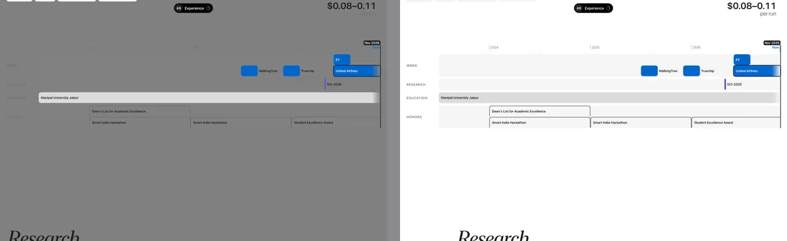

### 2. "AI & ML Engineer at United Airlines"

> REC-1 (P0) and WEB-3 (P1). The hero at every width, and the home page's JSON-LD.

**Issue.** "AI & ML Engineer" sat directly over "Now at United Airlines", and the JSON-LD said `jobTitle: "AI & ML Engineer"` with `worksFor: United Airlines`. Content gives the role at United as "AI & ML Intern (Generative AI)", and "intern" first appeared four and a half screens down.

**Fix.**

- **The chip** (`content/derive.ts`, `heroChips`) is the role at the company: "AI & ML Intern at United Airlines".
- **The JSON-LD's `jobTitle`** (`lib/structured-data.ts`) is the current role's, since it's read with its employer.
- **`profile.role`** ("AI & ML Engineer") stays as Akshat's own line. It's his to change, and it's listed below.

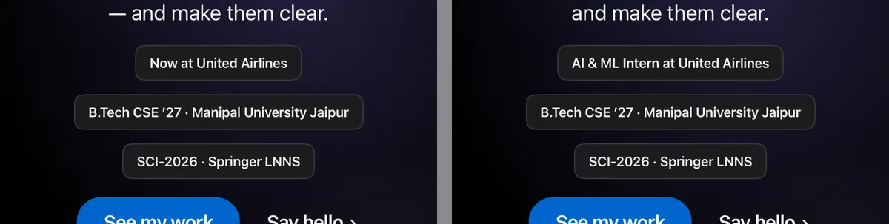

### 3. The papers read as Akshat's alone

> REC-5, P1. `/research/*`, the research section's Cite, and Google Scholar's tags.

**Issue.** The byline was "Akshat Sharma" alone, Cite gave "Sharma, A. (2026)…", and `citation_author` was only "Sharma, Akshat". But `coAuthors` is unknown, not empty, so that claimed more than content knows.

**Fix.** This supersedes Part 8's decision. While the co-authors are unknown:

- **Byline:** it reads "Presented by Akshat Sharma" (`copy.research.presentedBy`), which content does know.
- **Cite:** it waits until content names every author, since a citation names them all (`content/derive.ts`).
- **Scholar's tags:** they leave the authors out, since Scholar takes them as the whole list.

The Cite tests are kept, and skip with that reason until then.

### 4. The first ⌘K lost what was typed, and fired shortcuts

> HIG-1, P1, §6.3. The first Search of a visit, 1440.

**Issue.** The dialog's code loads on the first open, about 320ms. "cognivault" typed 0, 50 or 120ms after ⌘K left the field empty, and at 250ms it got "gnivault". The lost "g" reached the page and switched on the grid. While the index loaded, the panel said "No results for 'gnivault'", a false empty state.

**Fix.**

- **Held keys:** until the field is there, a key typed while Search is opening is kept for it (`lib/search/store.ts`, `typeAhead`), and no single-key shortcut fires.
- **The field:** the dialog gives the held text to the field as its own input.
- **Loading state:** while the index loads, the panel says "Searching…".

**After.** At 0, 50, 120 and 250ms the field holds "cognivault", and the grid stays off.

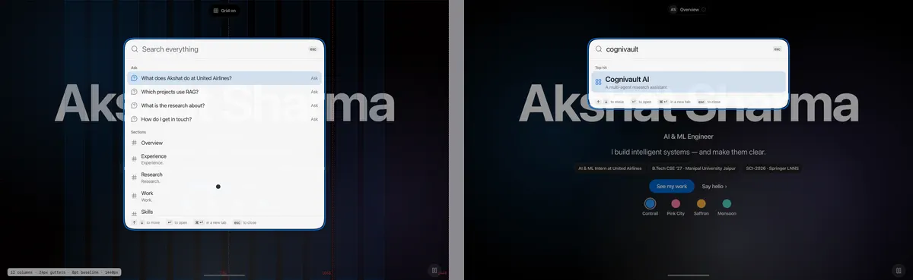

### 5. Island travel strobed the lights

> HIG-6, P2 by the panel, ranked P1 here: a full-screen flash is a WCAG 2.3.1 risk. The Island's Contact, from the top, light theme.

**Issue.** A smooth scroll covers 21,000px in about 200ms, and as it passed each section the backdrop cut to that section's light: dark, light, dark, light at 123, 183 and 264ms.

**Fix.**

- **Announcing the journey:** a journey announces itself (`lib/travel.ts`, `announceTravel`), from the Island's links, Search, Show me where and Ask's sources. The Island had its own copy of the travel code, and now calls `travelTo`.
- **Holding the light:** the controller holds the light until the page rests, then changes it once, crossfaded over 300ms.

**After.** One change, on arrival.

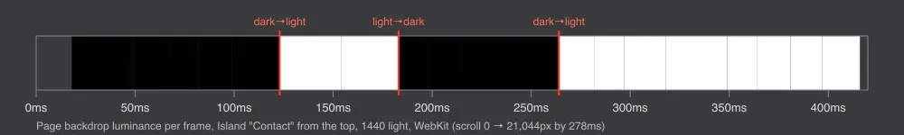

### 6. Focus that couldn't be seen

> A11Y-2, A11Y-3 and HIG-2, P1, WCAG 2.4.7.

**Issue.**

- **At a glance:** the Studying and Local time tiles clipped their buttons' focus rings (`overflow: hidden`), so none of the ring painted, at every width and in forced colors.
- **The chip:** in Skills' 3D edition, the first stop ("Light up the cores") sat at opacity 0 on a black stage for 11 seconds of Tab.

**Fix.**

- **The tiles:** the tile wears the ring (`.glance-tile:has(.glance-flip:focus-visible)`), as a work card does for its link, and gets a pressed state.
- **The die:** its focus skips the scene to the exploded chip, as the labels' did (`lib/skills-behavior.ts`).

**After.** In Chromium with the GPU, before focus the chip hadn't exploded and the die was at opacity 0. After focus the chip has exploded, and the die is at opacity 1 and focused.

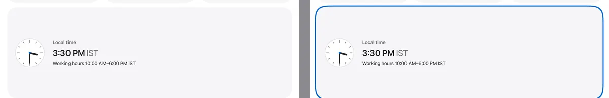
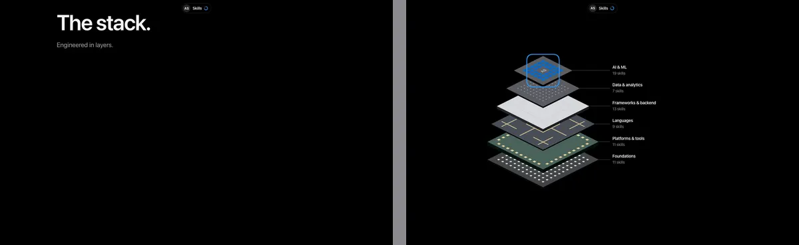

### 7. The highlights never said whose numbers they were

> WEB-2 (P1) and REC-6 (P2). The highlights reel.

**Issue.** "97% accurate.", "Top 50 of 300+.", "90%+ coverage." never said of what: only a tap on each card's + did. Beside its film at 1440, "Six documents. Two calls." broke a word to a line.

**Fix.** Each card names its subject over its words, from its reference in content: the company, the project, the honor, or the section (`reel()`, `subject`). The words beside the film are capped at a twentieth of the card (`--reel-text-cap`).

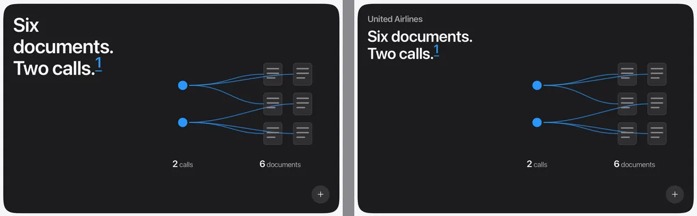

### 8. "84%" read as a grade

> WEB-4, P1. At a glance's Studying tile.

**Issue.** An unlabeled ring read "84%" over "B.Tech CSE". It's the share of the degree done, and the explanation was behind a click.

**Fix.** It reads "84% through B.Tech CSE".

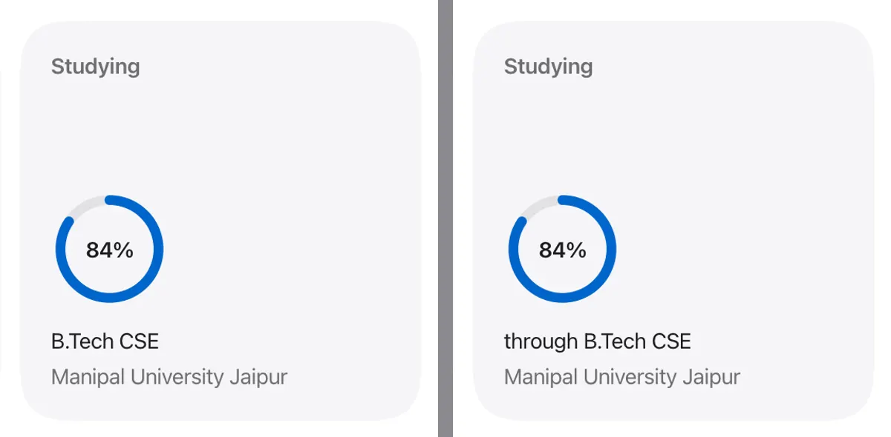

### 9. The scrubs laid out the whole page every frame

> PERF-1, P1. The edit, research's chapters and the statement.

**Issue.**

- **The playhead:** it moved by `left`, a layout every frame.
- **Rewrites:** its month label and the edit's counters rewrote their text every frame, even when it hadn't changed.
- **The statement:** it wrote its fill on every scroll of the whole page.
- **Research:** it restyled both drawings every frame.

**Fix.**

- **The playhead:** a layer as wide as the timeline, moved by `translate`, inside a layout-contained overlay.
- **Writes:** the label, the counters, the statement's fill and the chapters' play are written only when they change.

**After.** Chromium, 4× CPU, the pointer on the page, a full scroll of the home page:

| | Before | After |
|---|---|---|
| Frames missed | 27.8% | **14.2%** |
| Experience (the edit) | 46.4% | **28.5%** |
| Research | 32.4% | **9.0%** |
| The statement | 13.8% | **0%** |
| Skills | 22.7% | **6.9%** |
| Forced style and layout | 1,495ms | **821ms** |
| Layout | 2,075ms | **827ms** |
| Frames over 50ms | 16 | **10** |

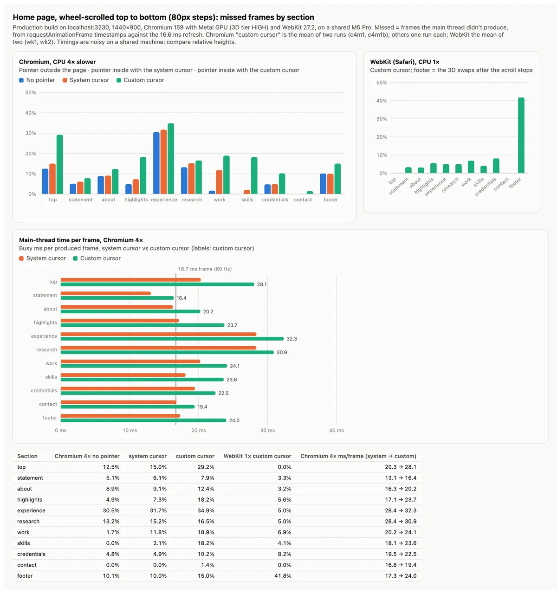

### 10. three.js loaded at the first touch

> PERF-4, P1. The 3D chunk, 270 KB over the wire.

**Issue.** It was fetched at the first wheel of every visit, and evaluated as a 102–113ms task in the middle of the statement's scrub; "/" for Search fetched it too. Visitors who never reached Skills still paid for it.

**Fix.** It's fetched as a scene approaches, three screens ahead, when its view registers (`components/three/stage.tsx`). This supersedes Part 16's first touch or ten idle seconds.

**After.** In Chromium with the GPU, nothing is fetched at the first wheel or through Experience and Research, and the chunk arrives at Work, three screens above Skills. Its evaluation is a 150ms frame there, paid only by visitors who come that far.

### 11. Chrome downloaded 279 KB of serif for a few titles

> PERF-5, P1. Newsreader on everything but Apple devices, which draw New York.

**Issue.** The variable font, with its optical-size axis, was 132 KB roman and 147 KB italic. A paper's page fetched the roman at VeryHigh priority.

**Fix.** The serif is only ever set at 400, so it's two static faces now, roman and italic (`lib/fonts.ts`).

**After.** A paper's page fetches one 22.5 KB face.

### 12. At 200% zoom the chip covered the core six

> A11Y-4, P1, WCAG 1.4.10 and 2.4.11. 640×450 CSS px, which is 1280×900 at 200%, 3D edition.

**Issue.** The sticky chip and its label list outgrew the screen. While the core six's links passed beneath it, clicks landed on the chip's labels.

**Fix.** Under 600px tall, the chip doesn't pin, and shows exploded (`@variant chip-short`).

**After.** Covered links, hit-tested through Skills in 60px steps:

| | Steps with a link covered | Most links covered at once |
|---|---|---|
| Before | 13 of 20 | 5 |
| After | 0 of 19 | 0 |

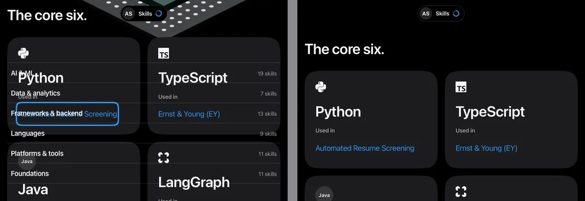

### 13. Headlines broke against their sense

> WEB-7 and HIG-7, P2, the brief's own check: no widows or orphans.

**Issue.**

- **The hero at 390:** the headline began a line with "—" ("— and make them clear.").
- **The statement at 1024:** it ended on a lone "everyone.", and at 1440 split its gradient phrase as "the clear / kind".
- **Contact at 1440:** "Let's build / something / clear.".

**Fix.**

- **No-break spaces** (`lib/typeset.ts`) keep a dash to the word before it, in every headline.
- **Last words:** they keep the last two words together where the measure holds them, the hero's headline and the statement.
- **The gradient phrase** holds one line.
- **The Resolve's split** breaks words on plain spaces only, so its lines are the final lines and nothing reflows when it reverts.

Contact's isn't fixed. Bound, "something clear." is about 560px at display size, its column is 352px at 1440, and the pair overflowed onto the composer, so it's under Open.

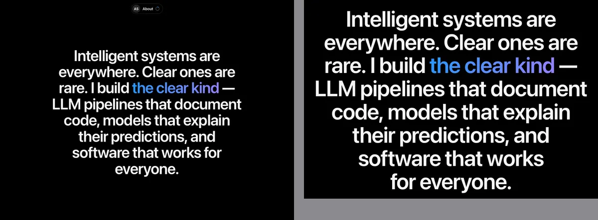

### 14. The current-role chip landed on 2023

> REC-4 (P1) and WEB-6 (P2). The hero's first chip, at 1440.

**Issue.** The chip went to Experience, where the pinned edit opens on its first clip, Manipal University in 2023. United, the role the chip names, only showed 2,440px into the section.

**Fix.** The chip links to the role's panel. With JavaScript it jumps there (`lib/jump.ts`), loading the edit's behavior first if it hasn't come near yet (`lib/behaviors.ts`), and the playhead springs to the role.

**After.** Tested from a fresh load at the top of the page: the panel on show is United's, and the playhead has settled on its clip.

### 15. The résumé couldn't be found

> REC-2, P1. Site-wide.

**Issue.** The print edition is a clean one-page résumé with no phone number in it, but nothing pointed to it except "Print any page" among the things to find. A recruiter needs a document.

**Fix.** The dock has a Résumé tile (`components/contact/dock.tsx`). It's a download once a phone-free PDF exists (§2 rule 2), and until then it prints the résumé edition. Printing needs JavaScript, so without it the tile isn't offered.

---

## Also fixed

- **A skip link** (A11Y-8, WCAG 2.4.1). "Skip to content" is the first stop on every page, past the Island's eleven.
  
- **The date line is Akshat's day** (REC-9, supersedes Part 5). It showed the visitor's date beside Akshat's time: "Wednesday … 10:50 AM IST" to a Chicago visitor, on a Thursday in India.
  
- **A View Transition never takes a click** (HIG-5). Mid-wipe, a second theme or finish click was lost to the transition's overlay.
- **Contact's live line is set in tabular figures** (HIG-9). "It's 1:11 PM IST" was 11px narrower than "It's 3:30 PM IST".
- **Highlights' and Research's headings sit on the content grid** (HIG-3 and WEB-9, in part). The reel's first card sits under its heading. About stays wide, for the reason under Open.
- **Nothing outside a scroll scene runs past 900ms, or loops at the screen's foot** (HIG motion check, PERF-9).
  - **The count-up:** 900ms, from 1.2s.
  - **The hero's scroll cue:** still. It breathed every 4s at the foot of the screen, and restyled the page 60 times a second while it did.

---

## The checks

| Check | Result |
|---|---|
| **Grid** | At 1024 and 390, every section sits on the 8 and 4 columns. At 1440, the section headings now share the content grid. About, the edit's timeline and viewer, and research's chapters stay wide as scenes. The two-column splits miss their columns by 20 to 43px (HIG-4, open). |
| **Optical alignment** | `hanging-punctuation: first` is set, and no block starts with punctuation. Display type's stems sit 0.06em inside their column edge, and cap heights don't meet the tops of the images beside them (HIG-10, open). |
| **Type** | The subpages use the scale alone. The home page has 20 sizes off it at 1440 (HIG-9, open). Headlines have no widows or orphans (fixed, #13), except Contact's at 1440 (open). Every size of 28px and up is tracked negative. Changing numerals are tabular (Contact's line, fixed). |
| **Rhythm** | Section padding is exact at every width (172.8, 122.9 and 96px). The lights now change in the gap between two ideas and never stop halfway (#1), and a journey changes them once (#5). Research and Skills spend the most scroll on the least content (WEB-5, open). |
| **Motion** | One vocabulary: every duration is a token, nothing under 150ms, springs at 880ms or less, and reduced motion gives 200ms fades. Over 900ms only in media the visitor can pause (the role visuals, up to 1.4s) and in scrubs. Nothing loops in the periphery now (the cue). Springs and CSS transitions can be interrupted, and the Resolve runs once, 700ms. |
| **States** | The composer (errors, sending, the mail-app fallback, delivered), copy, Search's error, and now its loading state, are all there. Under "Use system cursor", 16 of 29 controls show no hover and 15 no press, because their states live in the custom cursor (HIG-8, open). While sending, Send shows the disabled cursor instead of a busy one (open). |
| **The cursor** | Part 3's tests pass in WebKit and Chromium (`tests/e2e/cursor.spec.ts`). Across 5,040 points on every section at 1440 and 1024, in both themes and in pinned scenes, the dot sat on the pointer and stayed findable. Minor: during a change of light, the ink follows the surface token for about 130ms (shorter now that the fade is), and twice in the dark theme the dot froze for about 2s, which didn't recur in 2,478 replayed moves. |
| **Copy** | Sentence case and no exclamation marks. The buzzwords ("enterprise-level", "scalable") are only in the résumé's own text. "Two papers. One conference." and "10+ modules" carry no footnote mark (open: they need sources from Akshat). |
| **Truth and privacy** | No visible "TODO", "null" or "undefined" on any route. Nothing shaped like a phone number in the text, attributes, meta, JSON-LD, the print edition or the git history. Every number matches content. Two claims went beyond it, and are fixed (#2, #3). |
| **The 30-second test at 390** | Name ✓. Role ✓: "AI & ML Engineer", with "AI & ML Intern at United Airlines" under it. Current company ✓. A way to see work ✓ ("See my work"). A way to say hello ✓ ("Say hello ›"). |

---

## Measured again

Lighthouse 13.6, its phone profile under DevTools throttling, each page's median of three:

| Page | Before | After |
|---|---|---|
| Home | 0.99 · LCP 1.64s · blocking 23ms · CLS 0 | 0.99 · LCP 1.67s · blocking 17ms · CLS 0 |
| Cognivault AI | 1.0 · LCP 1.54s · blocking 18ms · CLS 0 | 1.0 · LCP 1.53s · blocking 8ms · CLS 0 |
| Food-waste paper | 1.0 · LCP 1.54s · blocking 36ms · CLS 0.016 | 1.0 · LCP 1.53s · blocking 31ms · CLS 0.017 |

Accessibility, best practices and SEO are 1.0 throughout. Load is unchanged within noise. The paper's small shift is still its TL;DR's face arriving, now 22.5 KB. First-load JS is 168.0 KB on the home page, 0.8 KB more for the type-ahead, the journey hold, the hero's jump and the skip link, against the 170 KB budget.

---

## Open

These were found and not fixed in this part, most severe first, with the reason.

| Issue | Severity | Why not now |
|---|---|---|
| **REC-1, `profile.role` "AI & ML Engineer"** on the cards, the title and the hero | P1 | Akshat's own line. The pairing with United is fixed; the line itself is his to keep or change. |
| **REC-3, the statement pins for about three screens before the first fact on a phone** | P1 | A design decision: the statement is the site's opening scene (§7). An unpinned, filled statement on phones would put the bio at 2.5 screens. |
| **WEB-7 and HIG-7, Contact's headline ends on "clear." alone at 1440** | P2 | Its column is 352px beside the thread, and "something clear." is about 560px at display size. A no-break space overflowed it onto the composer (tried and reverted). It needs a wider column or a smaller size: a layout decision. |
| **REC-8, the bio's "Before that I built … at EY"** | P2 | EY ran June to July 2026, starting the month United did. A content question for Akshat. |
| **REC-7 and WEB-8, résumé-speak** ("LLM model monitoring … for Fortune 500 enterprise-level ML models", "scalable") and Cartographer's numbers repeated five times on the home page | P2 | The words are Akshat's, from his résumé. Rewriting them is a content edit for him to approve. |
| **REC-10, location, graduation month and email are buried** | P2 | Content and layout choices: "India" is in the footer and fallback, and July 2027 is behind the Studying tile's flip. |
| **HIG-8, hover and press live in the cursor** | P2 | Every control needs a CSS hover and press of its own for "Use system cursor". It's a pass across every component. |
| **HIG-4, two-column splits off their columns**, and the About exception to the content grid | P2 | A layout pass. About's bento keeps fixed tile shapes that don't fit the content grid's narrower columns (tried and reverted: its words clipped). |
| **HIG-9, the home page's type scale drifts** (37.44, 31.68, 25.29, 22.85px …); straight apostrophes at display size | P2 | Mapping each component's size onto the scale is a pass across the sections. The apostrophes are content. |
| **WEB-5, Research and Skills spend 5.8 and up to 7 screens on two TL;DRs and the skills** | P2 | A content and structure decision (move the full lists to /specs?). |
| **WEB-10, subpages** | P2 | The case study repeats its stack three times; /compare says "Joined the stack: None" for 2023–24; the 404's sub-line falls to 1.9:1 where it crosses the blurred light. |
| **A11Y-5, at 320px a glance tile clips "B.Tech CSE", and two core names run off the page** | P2 | Fixed-shape tiles again; with HIG-4. |
| **A11Y-6, 200% text-only zoom overlaps Contact and Work** | P2 | Fixed-aspect boxes around text; full-page zoom passes. |
| **A11Y-7, the Education pass's ⓘ ring is 1.93:1** | P2 | A ring with a halo on the passes. |
| **PERF-3, the first render lays out the whole 23,000px page** (a 186ms task at 4×) | P2 | `content-visibility: auto` halved FCP in a test, but every scene caches its geometry. It needs its own part, with every scene re-checked. |
| **PERF-2, the cursor re-hit-tests on every scroll frame** | P2 | Partly eased: it forces a layout only after another script's writes, and the statement no longer writes on every scroll. The rest touches §2 rule 3's exactness. |
| **PERF-6 to PERF-8:** one 39.7 KB stylesheet for every route; the home page's HTML is 94.8 KB gzip, with SVG sent twice; 3D scenes build as the visitor stops | P2 | Each is a structural change for a later part. |
| **A11Y-9, the Island's toggle is 36pt tall on phones** (WCAG passes; §2 rule 7 asks 44); A11Y-10's nits (the colophon's table under text spacing, rings clipped at the Island's and the specs' edges, the hero's pause naming its state twice) | P3 | Small, and next. |

Every voice's full list is below, with its evidence.

---

## The panel's lists

The evidence paths are under `reports/part-17/`.

### HIG, the Apple Human Interface designer

| # | Issue | Severity | Evidence | Outcome |
|---|---|---|---|---|
| HIG-1 | The first ⌘K drops typing and fires shortcuts | P1 | `hig/search-cold-typed.png` | Fixed (#4) |
| HIG-2 | Keyboard focus vanishes: the chip's die, At a glance's tiles | P1 | `hig/chip-die-focus-11s.png`, `hig/focus-light-glance-localtime.png` | Fixed (#6) |
| HIG-3 | Two page grids at 1440 | P1 | `hig/grid-1440-experience-overlay.png` | In part: the headings |
| HIG-4 | Two-column splits miss the columns | P2 | `hig/grid-1440-credentials-overlay.png` | Open |
| HIG-5 | Theme and finish changes drop a second click | P2 | `hig/wipe-1-mid-first.png` | Fixed |
| HIG-6 | Island travel strobes | P2 | `hig/motion-travel-strobe.png` | Fixed (#5) |
| HIG-7 | Headlines break against their sense | P2 | `hig/type-1440-contact-headline.png` | Fixed (#13), but Contact's is open |
| HIG-8 | Hover and press live in the cursor | P2 | `hig/states-system-light-1440/states.json` | Open |
| HIG-9 | The type scale drifts; Contact's clock isn't tabular | P2 | `hig/typescale.json` | Clock fixed; scale open |
| HIG-10 | Optical alignment of display type | P3 | `hig/optical-1440-education.png` | Open |

### WEB, the apple.com web designer

| # | Issue | Severity | Evidence | Outcome |
|---|---|---|---|---|
| WEB-1 | The light changes leave text muddy | P1 | `web/transition-1440-light-research-to-work-worst.png` | Fixed (#1) |
| WEB-2 | The reel never says whose numbers they are | P1 | `web/reel-card3-1440.png` | Fixed (#7) |
| WEB-3 | The first screen reads as "AI & ML Engineer at United Airlines" | P1 | `shots/1440-light-motion/home-00-first-screen.png` | Fixed (#2) |
| WEB-4 | "84%" reads as a grade | P1 | `web/about-studying-tile-1440.png` | Fixed (#8) |
| WEB-5 | Scroll is spent where the content is thinnest | P2 | `web/geometry.json` | Open |
| WEB-6 | Experience opens on the university | P2 | `shots/1440-light-motion/home-05-experience.png` | Fixed for the chip (#14) |
| WEB-7 | Headline breaks | P2 | `web/lines.json`, `web/contact-1440.png` | Fixed (#13), but Contact's is open |
| WEB-8 | Résumé-speak and repetition | P2 | `web/copy.json` | Open (content) |
| WEB-9 | Two left edges at 1440 | P2 | `web/geometry.json` | In part: the headings |
| WEB-10 | The subpages | P2 | `shots/1440-light-motion/route-work-cognivault-ai-full.png` | Open |

### A11Y, the accessibility engineer

| # | Issue | Severity | Evidence | Outcome |
|---|---|---|---|---|
| A11Y-1 | Text loses contrast wherever the lights change (1.4.3) | P1 | `a11y/crossfade-midpoint-experience-timeline.png` | Fixed (#1) |
| A11Y-2 | No focus ring on Studying and Local time (2.4.7) | P1 | `a11y/kbd-home-light-021.png` | Fixed (#6) |
| A11Y-3 | "Light up the cores" takes focus while invisible (2.4.7) | P1 | `a11y/die-tab-light-motion-2500.png` | Fixed (#6) |
| A11Y-4 | At 200% zoom the sticky chip covers the core six (1.4.10) | P1 | `a11y/zoom-z200-focus-under-chip.png` | Fixed (#12) |
| A11Y-5 | At 320px, text clips and the page scrolls sideways | P2 | `a11y/reflow-320-glance.png` | Open |
| A11Y-6 | 200% text-only zoom overlaps Contact and Work | P2 | `a11y/zoom-text200-y23040.png` | Open |
| A11Y-7 | The Education pass's ⓘ ring is 1.93:1 | P2 | `a11y/kbd-home-light-140.png` | Open |
| A11Y-8 | No skip link; Skills is 87 Tab stops | P2 | (Tab count) | Skip link fixed; stops open |
| A11Y-9 | The Island's toggle is 36pt on phones | P3 | (hit test) | Open |
| A11Y-10 | Nits: the colophon's table, clipped rings, the pause's double state | P3 | `a11y/spacing-390-colophon-table.png` | Open |

### PERF, the performance engineer

| # | Issue | Severity | Evidence | Outcome |
|---|---|---|---|---|
| PERF-1 | The scrubs re-lay out the whole page every frame | P1 | `perf/scroll.txt`, `perf/scroll-frames-by-section.png` | Fixed (#9) |
| PERF-2 | The cursor re-hit-tests on every scroll frame | P1 | `perf/scroll.txt` | In part |
| PERF-3 | The first render lays out the whole page | P1 | `perf/load-home.txt` | Open |
| PERF-4 | three.js loads at the first touch | P1 | `perf/interactions.txt` | Fixed (#10) |
| PERF-5 | 279 KB of serif in Chrome | P1 | `perf/bytes-and-caching.txt` | Fixed (#11) |
| PERF-6 | One render-blocking stylesheet for every route | P2 | `perf/css-coverage.txt` | Open |
| PERF-7 | 94.8 KB gzip of HTML, SVG sent twice | P2 | `perf/load-home.txt` | Open |
| PERF-8 | 3D scenes build right as the visitor stops | P2 | `perf/webkit-3d-swaps.txt` | Open |
| PERF-9 | The hero animates on the main thread while idle | P2 | `perf/idle.txt` | Fixed (the still cue) |
| PERF-10 | Opening a case study is a 181ms frame at 4× | P2 | `perf/interactions.txt` | Open |

### REC, the recruiter

| # | Issue | Severity | Evidence | Outcome |
|---|---|---|---|---|
| REC-1 | "AI & ML Engineer" everywhere; "intern" four and a half screens down | P0 | `recruiter/first-screen-iphone15.png` | The pairing fixed (#2); the line is Akshat's |
| REC-2 | The phone-free résumé can't be found | P1 | `recruiter/print-edition-home.png` | Fixed (#15) |
| REC-3 | Three screens of statement before the first fact | P1 | `recruiter/timed/iphone15-t5s.png` | Open (design) |
| REC-4 | At 1440, the role chip lands on the university | P1 | `recruiter/desktop/01-after-now-at-united-chip.png` | Fixed (#14) |
| REC-5 | The papers credit Akshat alone | P1 | `recruiter/research-page-phone.png` | Fixed (#3) |
| REC-6 | Highlights are slogans with no subject | P2 | `recruiter/taps/07-highlight-sheet.png` | Fixed (#7) |
| REC-7 | Jargon in the most-read lines | P2 | `shots/390-light-motion/home-05-experience.png` | Open (content) |
| REC-8 | The bio contradicts the dates | P2 | `shots/390-light-motion/home-03-about.png` | Open (content) |
| REC-9 | The date line was wrong for the Americas | P2 | `recruiter/first-screen-iphone15.png` | Fixed |
| REC-10 | Location, graduation month and email are buried | P2 | `recruiter/text/phone-home.txt` | Open |
